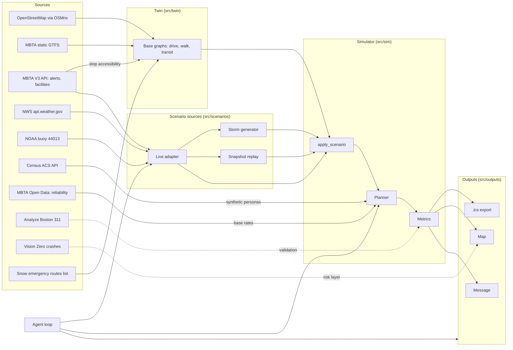

# Design Document

## Today's build: Blizzard Stress-Test Simulator (v1)

This section is what the team builds today. Everything after "Overview" is the longer-term design; where they differ, **this section wins for today**.

**What it looks like:** a Streamlit page. Sliders on the left (snowfall, start time, hour to view, % of cars moved, E branch suspended). A map of Longwood + Fenway on the right with roads colored by capacity and origin dots colored by minutes to the nearest hospital. KPI cards on top. A toggle switches to the breaking-point map: how many inches of snow it takes to break each location.

**Stack:** Python, Streamlit, OSMnx + NetworkX, Folium via `streamlit-folium`. All effects are rule-based; no LLM in the simulator.

**Simplification vs. the long-term design:** the scenario is a plain dict (`src/contract.py`) instead of a list of `Disruption` objects. Live data later fills the same dict: an MBTA E-branch suspension alert sets `green_e_suspended`, elevator closure alerts fill `elevators_out`, and the weather service forecast fills `snow_inches`, `start_hour` and `duration_hours`.

### Pipeline for one `run_simulation(scenario, hour)`

```text
cached drive graph (A)
  → per edge: road class (priority / main / side)              [A tags once]
  → snow on road at `hour` from accumulation + plow schedule   [B]
  → capacity factor (table, parked cars, side-street closure)  [B]
  → volume: base v/c by class and hour, demand drop, +E effect [B]
  → travel time = free-flow / cap^0.5 × BPR(v/c)               [B]
  → multi-source Dijkstra from the 3 hospital nodes on the
    REVERSED graph → minutes to nearest hospital for every node [B]
  → origins + KPIs
```

**Speed tip for B:** one `nx.multi_source_dijkstra_path_length(G.reverse(copy=False), hospital_nodes, weight="sim_time")` gives every origin's time to its nearest hospital in a single call. The breaking-point sweep is then 16 of these calls, which takes seconds, not minutes.

**Origins:** intersections (nodes with street count ≥ 3) inside the bbox, roughly 1,000 points. If the map is slow, C samples every Nth origin for display only.

**Hospitals:** Beth Israel Deaconess, Brigham and Women's, Boston Children's. A takes their locations from OSM (`amenity=hospital`), snaps each to the nearest drive-graph node, and saves them in `data/cache/hospitals.json`. Check the snapped nodes on the map: snap to the emergency entrance street, not an internal service road.

**Personal layer (if time):** `trip_time(origin, dest, scenario, hour)` runs a single shortest path on the same weighted graph and compares it to the clear-day time. For transit riders it adds a warning if a stop on their usual line is in `elevators_out`.

### File ownership (avoids merge conflicts)

| Owner | Files |
|---|---|
| A: Road network & data | `src/twin/network.py`, `src/twin/hospitals.py`, `src/adapters/*`, `data/cache/` |
| B: Simulation logic | `src/sim/*`, `src/contract.py` (replaces stubs), `tests/sim/*` |
| C: UI & map | `app.py`, `src/outputs/map.py`, `src/outputs/ics.py` |
| D: Parameters & demo | `config/params.py`, `config/scenarios.py`, `.kiro/steering/*`, `README.md`, `src/outputs/messages.py`, demo script |

## Overview

Storm Twin has three layers, built in this order:

1. **The twin and simulator** (core, built first). Real street and transit graphs for Longwood and Fenway, a single `Disruption` model, a storm generator, and a planner that answers "what are this persona's options for this trip under this scenario?"
2. **Data adapters** (built second). Each source turns into one of three things: part of the base graph, a `Disruption`, or a persona attribute. Adapters never touch the planner directly.
3. **The agent and outputs** (built last). A loop that reads a persona's schedule, builds a "live" scenario from adapters, runs the planner, and emits an .ics file, a map and a short message.

The key design decision: **everything that changes the world is a `Disruption`.** A live MBTA shuttle alert, a historical replay of last February's blizzard, and a "what if 12 inches fall at 8am" slider all produce the same objects. The simulator is tested once against synthetic scenarios, and live data is just one more scenario source.

## Architecture



## How each data source enters the system

This is the most important table in the design. Every source has exactly one job.

| Source | Becomes | Module | When it is read | Notes |
|---|---|---|---|---|
| OpenStreetMap (OSMnx) | Drive and walk graphs: nodes, edges with `length`, `speed_kph`, `travel_time` | `twin/network.py` | Once, then cached as GraphML | `ox.graph_from_bbox` with `network_type="drive"` and `"walk"`; `ox.add_edge_speeds` and `ox.add_edge_travel_times` give free-flow times |
| Boston snow emergency routes | Edge attribute `snow_route=True` | `twin/network.py` | Once | Match by street name (Huntington Ave, Longwood Ave, Ruggles St, Tremont St, Hemenway St); hand-check on the map |
| MBTA static GTFS | Transit graph: stops, route segments with scheduled in-vehicle time, route headways by time of day | `twin/transit.py` | Once, then cached | Filter stops to the bbox; compute headway per route per hour from `stop_times`; mark E branch Huntington segments `street_running=True` |
| MBTA V3 `/stops` and `/facilities` | Stop attributes `wheelchair_boarding`, `elevators=[...]` | `twin/transit.py` | Once | Facilities with type ELEVATOR, filtered by stop |
| MBTA V3 `/alerts` | `Disruption`s: transit_suspension, shuttle_replacement, transit_delay, elevator_outage, road_slowdown (bus detours) | `adapters/mbta.py` | Every poll (live) | Map `effect` + `informed_entity` (route, stop, direction) to graph elements; keep `active_period` |
| NWS `/alerts/active?point=` and `/points` → `forecastGridData` | `StormInputs(snow_rate_in_hr, snow_accum_in, wind_mph, start)` | `adapters/nws.py` | Every poll (live) | Requires a User-Agent header; winter storm, blizzard and high-wind products set the inputs; inputs go to the storm generator |
| NOAA buoy 44013 | "Approaching storm" indicator (pressure trend, wind) | `adapters/buoy.py` | Every poll (stretch) | Display only; does not drive the simulator |
| Census ACS API | Per-tract shares: 65+ living alone, households with no vehicle, population | `personas/synthetic.py` | Once | Used to generate synthetic personas for the city-scale map |
| MBTA Open Data Portal (reliability) | Base rate table: `line × month × weekday → P(disruption)` | `history/base_rates.py` | Once | Powers Requirement 9's heads-up; never used as a prediction |
| Analyze Boston 311 (CKAN) | Validation set: snow/plow complaints by street for past storm dates | `validation/snow311.py` | Once (stretch) | Compare against the generator's most-slowed streets |
| Vision Zero crashes | Map risk layer | `outputs/map.py` | Once (stretch) | Not used in routing; label the data-quality caveat |
| MassDOT work zones | `Disruption`s: road_closure, road_slowdown | `adapters/massdot.py` | Stretch | Needs a free account and API key |
| Live snapshots (our own) | Replayable `Scenario` | `scenarios/replay.py` | On demand | Every poll writes `data/snapshots/<timestamp>.json` |

Sources that will not be used now: MassDOT real-time travel times (require a form-based access request; listed on the roadmap) and MassDOT traffic counts (no API; optional manual baseline).

## Components and interfaces

### Data model (`src/twin/model.py`)

```python
class DisruptionKind(str, Enum):
    ROAD_SLOWDOWN = "road_slowdown"          # severity = speed multiplier lost, 0..1
    ROAD_CLOSURE = "road_closure"            # severity = 1
    TRANSIT_DELAY = "transit_delay"          # severity = added minutes per segment
    TRANSIT_SUSPENSION = "transit_suspension"
    SHUTTLE_REPLACEMENT = "shuttle_replacement"
    ELEVATOR_OUTAGE = "elevator_outage"
    RIDESHARE_SURGE = "rideshare_surge"      # severity = surge multiplier

@dataclass(frozen=True)
class Target:
    layer: Literal["drive", "walk", "transit", "stop", "rideshare"]
    ids: tuple[str, ...]                     # edge ids, stop ids, route ids, or ("*",)

@dataclass(frozen=True)
class Disruption:
    kind: DisruptionKind
    target: Target
    severity: float
    start: datetime
    end: datetime | None
    source: Literal["storm", "mbta", "nws", "massdot", "replay", "manual"]
    reason: str                              # plain language, shown to users

@dataclass
class Scenario:
    name: str
    at: datetime
    disruptions: list[Disruption]
    stale_since: datetime | None = None      # Requirement 8.4
```

```python
@dataclass
class Persona:
    id: str
    home: LatLon
    age_group: Literal["<18", "18-64", "65+"]
    step_free: bool
    max_walk_m: int
    has_car: bool
    ride_budget_usd: float
    prefers_low_carbon: bool
    trips: list[Trip]
    synthetic: bool = True

@dataclass
class Trip:
    id: str
    label: str                  # "Brigham pharmacy", never a diagnosis
    dest: LatLon
    arrive_by: datetime
    recurrence: str | None      # RRULE string
    usual_mode: Literal["walk", "transit", "rideshare", "drive"]
    priority: Literal["critical", "important", "flexible"]

@dataclass
class Option:
    legs: list[Leg]
    depart_at: datetime
    arrive_at: datetime
    walk_m: int
    cost_usd: tuple[float, float]   # low, high (estimate range)
    co2_g: float
    transfers: int
    disrupted_segments: int
    feasible: bool
    infeasible_reasons: list[str]
```

### Twin (`src/twin/network.py`, `src/twin/transit.py`)

- `load_twin(bbox, cache_dir) -> Twin` returns the three graphs plus stop and route metadata.
- `Twin.with_scenario(scenario) -> Twin` returns a **copy** with edge weights and availability modified. The baseline is never mutated, which satisfies Requirement 2.5 for free.

Transit routing uses a **frequency-based graph** rather than a full timetable router, which is enough for a 5-hour build:

- Nodes: stops. Edges: consecutive stops on a route with `in_vehicle_min` from GTFS.
- Boarding cost: `headway_min / 2` (expected wait) for the route at that hour.
- Transfers: walk edges between stops within 250 m, plus a 3-minute transfer penalty.
- Access and egress: walk graph from origin to the nearest few stops and from stops to the destination.

If time allows later, swap in OpenTripPlanner for timetable-accurate routing; the planner interface does not change.

### Applying a scenario (`src/sim/apply.py`)

For each Disruption kind:

| Kind | Effect on the copied twin |
|---|---|
| road_slowdown | Drive edge `travel_time /= (1 - severity)`, capped at the closure threshold |
| road_closure | Remove the drive edge |
| transit_delay | Add `severity` minutes to each targeted segment |
| transit_suspension | Remove targeted segments |
| shuttle_replacement | Replace targeted segments with road-based shuttle edges: in-vehicle time from the drive graph (already slowed by the storm) × 1.3, plus 10 minutes of boarding delay; shuttle stops inherit accessibility from a lookup, default not step-free unless confirmed |
| elevator_outage | Set `step_free=False` on the stop |
| rideshare_surge | Set the twin's surge multiplier to the max of current and `severity` |

Overlap rule (Requirement 2.4): group by (kind, target element, time), keep the max severity.

### Storm generator (`src/scenarios/storm.py`)

`generate_storm(inputs: StormInputs, twin: Twin) -> Scenario`

All coefficients live in one dict `STORM_COEFFS` and are mirrored in `.kiro/steering/simulation-assumptions.md` (a hook keeps them in sync). Shape of the model:

- **Roads:** `slowdown = clamp(a * snow_rate + b * accum + c * max(0, wind - 25), 0, 0.8)`. Snow emergency routes use `slowdown * plow_factor` with `plow_factor < 1`. Above an accumulation threshold, non-snow-route residential edges become `road_closure` with a small probability (seeded RNG so runs repeat).
- **Transit:** headway multiplier and per-segment delay grow with snow rate. E branch street-running segments get an extra sensitivity multiplier and switch to `shuttle_replacement` above a threshold. Buses inherit the road slowdown of the edges they run on.
- **Rideshare:** surge rises with snow rate and with any rail suspension in the bbox (Requirement 10.2), and pickup wait rises with the road slowdown.
- **Monotonicity:** every formula is non-decreasing in every input (Requirement 3.4); a property-based test checks this.

Presets: `CLEAR`, `MODERATE_SNOW` (about 1 in/hr, 4 in accumulated), `BLIZZARD` (about 2.5 in/hr, 14 in accumulated, 45 mph gusts).

### Planner (`src/sim/planner.py`)

`plan(trip, persona, twin_s, now) -> PlanResult`

1. Generate candidates: walk-only; transit (k-shortest over the frequency graph, k = 3); rideshare (drive graph time + pickup wait); transit + walk combinations come naturally from the transit graph.
2. Score each candidate: arrival time, walk distance, cost range, CO2, transfers, disrupted segments.
3. Feasibility filters, in order (each adds a reason string):
   - step-free required and any boarding/alighting stop not step-free → infeasible (5.2)
   - walk distance > `max_walk_m` → infeasible (5.3)
   - arrival > `arrive_by` → late (still shown, ranked low)
   - high cost estimate > budget → over budget (5.4)
4. Departure buffer: critical +20 min, important +10 min (6.1, 6.2).
5. Ranking:
   - critical trips: lexicographic on (feasible, on time, disrupted_segments, transfers, arrival)
   - others: (feasible, in budget, on time, arrival), then the sustainability swap rule (12.2)
6. Stranded if no feasible on-time option; attach fallbacks (5.5).
7. Baseline: run the persona's `usual_mode` with its usual departure on the same scenario twin (7.1).

### Metrics (`src/sim/metrics.py`)

- `time_saved_min = baseline_delay - recommended_delay`, where delay is arrival time minus `arrive_by` (floored at 0). Never computed against a clear-day baseline (7.2).
- City-scale: for each tract, sample N synthetic personas and compute the share who reach the nearest Longwood hospital within 30 minutes, plus the stranded count (7.3).
- Every metric object carries `label="simulation estimate"` (7.4).

### Live adapter (`src/adapters/`)

- `mbta.py`: `GET https://api-v3.mbta.com/alerts?filter[route]=Green-D,Green-E,<bus routes>&filter[activity]=BOARD,EXIT,RIDE,USING_WHEELCHAIR` with the `x-api-key` header. Effect mapping: SUSPENSION → transit_suspension; SHUTTLE → shuttle_replacement; DELAY → transit_delay (severity from the alert's severity field, mapped to minutes); DETOUR → road_slowdown on the bus route; ELEVATOR_CLOSURE → elevator_outage; STOP_CLOSURE and STATION_CLOSURE → transit_suspension at that stop. Unknown effects are logged and skipped.
- `nws.py`: `GET https://api.weather.gov/points/{lat},{lon}` to find the gridpoint, then `forecastGridData` for `snowfallAmount` and `windSpeed`, and `GET /alerts/active?point={lat},{lon}` for product types. Send `User-Agent: StormTwin (team contact email)`.
- Each adapter returns `(disruptions or inputs, fetched_at)`; failures fall back to the latest snapshot and set `stale_since` (8.4). Every successful poll writes a snapshot (8.5).

### Agent loop (`src/agent/run.py`)

```text
for persona in personas:
  scenario = live_scenario(now)              # adapters + storm generator
  for trip in persona.trips_within(next 24h):
    result = plan(trip, persona, twin.with_scenario(scenario), now)
    if changed(result) or (trip.critical and affected(result)):
      write .ics, render map, compose message
```

The LLM is used only for (a) composing the plain-language message from a structured `PlanResult` and (b) optional conversational onboarding. It never chooses the route. A deterministic checker validates every message: under 320 characters, mentions the departure time, recommends only a feasible option (13.3).

### Outputs (`src/outputs/`)

- `ics.py`: Python `icalendar`; one `VEVENT` "Leave by HH:MM: <mode summary>" with a VALARM 15 minutes before, plus a travel block event.
- `map.py`: folium or pydeck: baseline route grey dashed, recommended route solid, disrupted segments red, closed elevators as icons; city mode renders a tract choropleth of reachability.
- `messages.py`: template-first, LLM-polished; the checker runs on the final string.
- App shell: Streamlit with two tabs, **City view** (scenario picker + reachability map) and **My trips** (persona picker + recommendation, map, .ics download, time saved).

## Error handling

| Failure | Behavior |
|---|---|
| OSM or GTFS fetch fails at startup | Load from cache; if no cache, fail loudly (the demo must pre-build the cache) |
| MBTA or NWS poll fails | Use the last snapshot, show "data as of HH:MM" (8.4) |
| Alert references an entity outside the bbox | Skip it |
| Unknown alert effect | Log the effect name only, skip |
| Planner finds no path at all | Trip is stranded, show fallbacks |
| LLM call fails | Send the template message unpolished |

## Testing strategy

- **Unit tests** for each Disruption kind in `apply.py` on a tiny hand-built graph.
- **Property-based tests** (Hypothesis) for the core guarantees, using Kiro's Correctness feature where available:
  - monotonicity of the storm generator (3.4)
  - apply then remove returns the baseline (2.5)
  - a step-free persona never gets a recommended option through a non-step-free stop (5.2)
  - time saved is never negative when the recommendation is the planner's top option
- **Recorded fixtures**: save a few real MBTA alert and NWS responses into `tests/fixtures/` and test adapters against them, never against the live API in CI.
- **Scenario snapshot test**: the blizzard preset on the cached twin produces a stable stranded count (catches accidental model changes).
